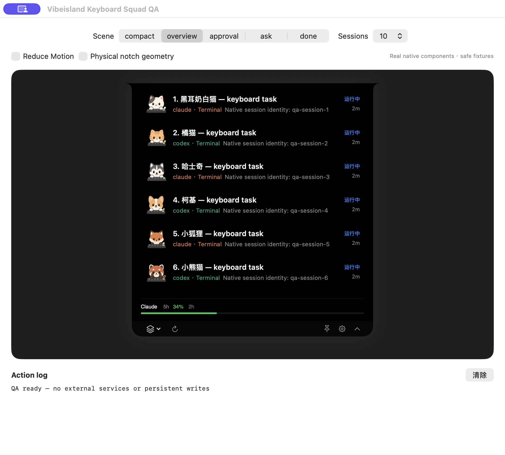
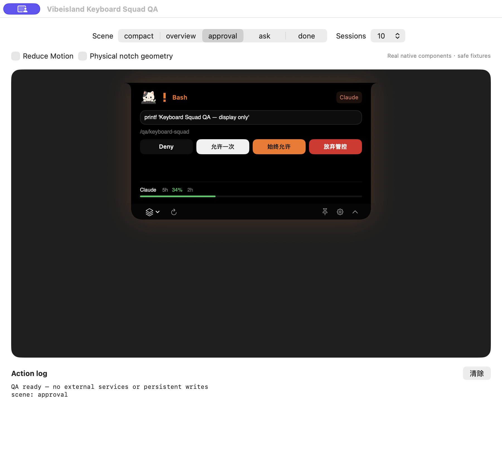
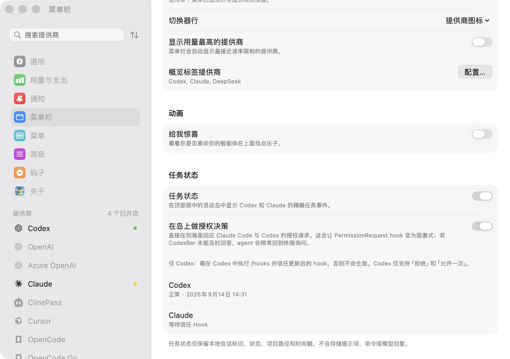

<div align="center">
  
  <h1>Vibe Island</h1>
  <p><strong>让 AI 编程任务，住进 Mac 的灵动岛。</strong></p>
  <p>看进度、等授权、回到会话，也顺手看一眼还剩多少额度。</p>
  <p>
    
    
    <a href="LICENSE"></a>
  </p>
  <p><a href="#安装">安装</a> · <a href="#开始使用">开始使用</a> · <a href="#产品界面">产品界面</a> · <a href="https://github.com/Richard-Yang0130/vibe-island/issues">反馈问题</a></p>
</div>

Vibe Island 是一个 macOS 原生应用，把 **Codex、Claude Code 和 DeepSeek Harness 的任务状态**放到屏幕顶部。任务运行时收起成小岛，需要查看、处理支持的授权请求或回到应用时再展开。多个任务同时跑，也能在同一处找到它们。

项目由 Perch 更名而来，基于 [CodexBar](https://github.com/steipete/CodexBar) 开发，保留多提供商用量与费用查看能力。应用包名为 `Vibeisland.app`，部分设置页、CLI 和源码标识仍沿用 CodexBar。

最新源码已接入 **DeepSeek Harness 桌面端**：任务状态、完成提醒、启动和断连恢复均可使用。启用任务状态后会自动配置本地插件；审批继续在 Harness 中处理。详见 [更新日志](CHANGELOG.md) 和 [Harness 接入说明](Scripts/deepseek-harness/README.md)。

## 产品界面

以下为 Retina 原生高清截图，点击图片可查看原图。



*多会话总览。此图来自项目自带的原生演示窗口，使用示例任务和示例额度；保留演示控件，未将其包装为真实账户数据。*

### 一个地方，看清任务状态

- **运行、等待、完成**：收起时用简短状态和指示灯提示，展开后查看具体会话。
- **多会话列表**：区分 Codex、Claude Code 与 DeepSeek Harness，显示运行、等待和结束状态；Codex 入口检查会话是否可以恢复，Harness 入口唤起桌面应用。
- **键盘小伙伴**：十种角色自动分配并持久绑定任务，角色动效跟随任务状态，不监听你的键盘输入。
- **需要你时再处理**：支持授权请求和等待回答的提醒。开启岛内授权后，可在支持的 hook 流程里直接回应请求。
- **用量一起看**：查看当前提供商的额度、重置倒计时，以及支持的费用记录。具体指标取决于提供商和登录方式。
- **原生交互**：悬停展开、置顶、Esc 或点击外部收起，并适配系统的“减少动态效果”。

### 在岛上处理授权



*原生组件演示，不执行截图中的请求。授权选项取决于 Agent：Codex 支持拒绝、允许一次；Claude Code 可提供更多选项。*

## 安装

需要 **macOS 14 或更新版本**；从源码构建需要 **Xcode 与 Swift 6.2 或更新版本**。当前版本已在 Apple Silicon Mac 上验证。

目前本仓库尚未发布可下载的 Release 安装包，可以从源码构建：

```bash
git clone https://github.com/Richard-Yang0130/vibe-island.git
cd vibe-island
./Scripts/package_app.sh release
open Vibeisland.app
```

构建完成后，也可以把 `Vibeisland.app` 拖入“应用程序”文件夹。默认构建使用本地 ad-hoc 签名，不包含 Apple 公证。上游 CodexBar 的 Homebrew 包不是此版本的 Vibe Island。

## 开始使用

1. 打开设置，启用你使用的提供商，并按对应页面配置登录来源。
2. 在 **设置 → 菜单栏 → 任务状态**中启用灵动岛，按应用提示配置 Codex / Claude Code 的任务 hooks；检测到 DeepSeek Harness 桌面端时，自动加载本地状态插件。
3. 如需直接在岛上处理授权，启用该区域的授权选项。Codex 还需要在 `/hooks` 中信任更新后的 hook。
4. 开始一个编程任务。悬停查看会话，点击卡片回到任务；需要保持展开时使用置顶按钮。



*当前应用设置截图。任务显示依赖对应 Agent 的事件接入；未连接的 Agent 不会自动出现。*

## 提供商与数据来源

灵动岛的任务事件接入面向 **Codex、Claude Code、DeepSeek Harness 桌面端**。Harness 支持任务状态、完成提醒、启动和断连恢复，审批继续在 Harness 原界面处理；当前点击入口唤起应用，尚不定位指定聊天。接入说明和复现验证见 [Harness 接入记录](Scripts/deepseek-harness/README.md)。用量查看还支持 Cursor、Gemini、DeepSeek、z.ai、MiniMax 等提供商。支持查看额度不等于支持该提供商的任务事件。

用量模块当前注册 66 个提供商 ID，具体数据来源与支持范围见下列文档。

| 需要配置什么 | 文档 |
| --- | --- |
| Codex 登录与用量 | [Codex](docs/codex.md) |
| Claude 登录与用量 | [Claude](docs/claude.md) |
| Cursor | [Cursor](docs/cursor.md) |
| Gemini | [Gemini](docs/gemini.md) |
| CLI 配置 | [CLI configuration](docs/cli-configuration.md) |
| 新增提供商 | [Provider guide](docs/provider.md) |
| 钥匙串访问说明 | [Keychain prompts](docs/keychain-prompts.md) |

任务状态在本机处理；用量查询会访问你启用的提供商。浏览器凭据、OAuth、API key 与本地会话文件的使用方式各不相同，以对应配置页和文档为准。键盘角色不采集键盘输入。

## 开发

```bash
swift build                       # 编译
make check                        # 格式、静态检查及文档检查
make test                         # 完整分组测试
./Scripts/compile_and_run.sh       # 构建并重启应用
```

源码中的模块和可执行文件仍使用 `CodexBar` 名称。原生演示入口用于查看示例任务、角色和授权界面，不连接真实账户：

```bash
swift build
.build/debug/CodexBar --keyboard-squad-preview
```

## 致谢与许可证

Vibe Island 基于 Peter Steinberger 及贡献者维护的 [CodexBar](https://github.com/steipete/CodexBar)，并延续其 [MIT 许可证](LICENSE)。感谢上游的提供商接入、用量解析与 macOS 基础能力。原有版权和第三方资源许可证保留在仓库中。
