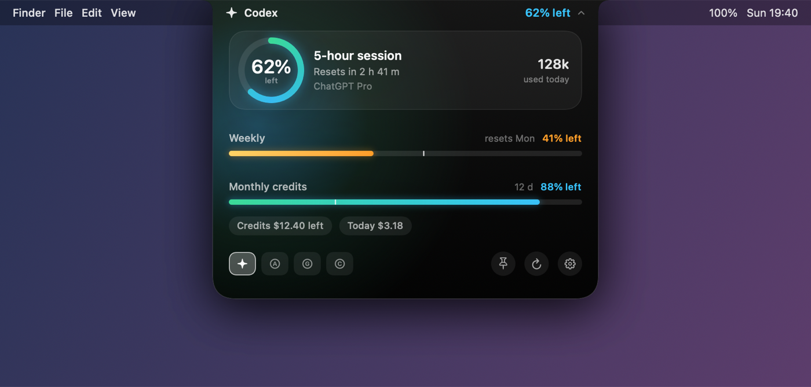
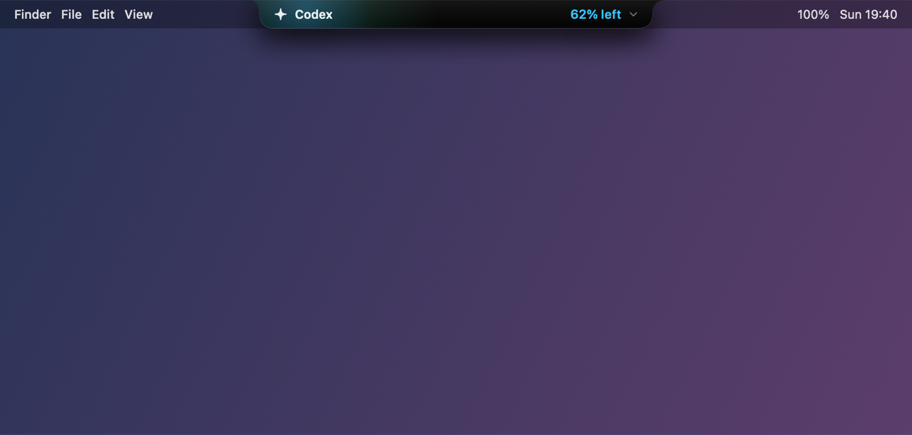

# Perch

**Perched on your notch, watching your AI budget.**

[](https://www.apple.com/macos/)
[](https://swift.org)
[](LICENSE)
[](https://github.com/steipete/CodexBar)

Perch lives inside your MacBook's notch. It is invisible until your pointer arrives — then it
unfolds into a Dynamic Island panel showing exactly how much of every AI coding plan you have left,
and when each window resets.



> **On the images:** these are design renders produced from the same layout code the app ships,
> with placeholder numbers. They are an accurate picture of the composition and colour, not live
> screenshots. Real captures will replace them.

---

## Attribution, up front

Perch is a fork of **[CodexBar](https://github.com/steipete/CodexBar)** by
**[Peter Steinberger](https://github.com/steipete)**, MIT licensed.

Everything that makes the app genuinely useful — the 66 provider integrations, the quota parsers,
the OAuth/cookie/CLI plumbing, the cost scanning, the widgets, the CLI, the 22 localisations — is
his work, and it is a lot of it. Perch keeps all of that intact, keeps the MIT licence and his
copyright notice, and replaces one thing: the surface you look at.

If you want the original, well-supported, actively released app, **go get CodexBar.** It is on
Homebrew (`brew install --cask codexbar`) and at [codexbar.app](https://codexbar.app).

---

## What Perch changes

Upstream CodexBar puts a status item in your menu bar. Perch takes that surface and hides it in the
notch instead, on a three-stage reveal.

### Asleep

Nothing. The window is exactly the size of the physical notch, filled with pure black, so it is
invisible against hardware that has no pixels there. Your menu bar is completely unobstructed.

The one exception: when a quota crosses 82% consumed, a 3pt sliver breathes under the notch. Quiet
until it matters.

### Peek — pointer approaches



Two wings grow out of either side of the camera housing — provider on the left, remaining quota on
the right — at exactly menu-bar height. The physical notch becomes the middle of the widget. That
is the whole trick, and it is why it reads as hardware rather than as a floating window.

### Expanded — pointer settles (200ms), or click

The island drops into a 428pt panel whose top corners curl *inward* to meet the menu bar:

- **A ring gauge** for the primary window, angular-gradient stroked and glowing, percentage in SF Rounded at the centre
- **Gradient meters** for the remaining windows, each with a pace marker showing whether you are burning faster than the clock
- **Spend chips** — credit balance, today's cost — when the provider reports them
- **A provider row** to switch accounts in one click, plus refresh, pin, and settings

Colour is driven by severity, not decoration: mint→cyan while healthy, amber past 55% consumed,
coral→crimson past 82%. Ring, meters, and numerals all move together, so the panel's temperature
tells you the story before you have read a single digit.

Move away and it collapses after a 320ms grace period. Click the pin to keep it open. Esc closes it.
On launch it peeks once and tucks itself away — a hidden control nobody knows about is a broken
control.

### How it is built

| Concern | Approach |
|---|---|
| Window | One borderless `NSPanel` above the menu-bar level, `canJoinAllSpaces` + `fullScreenAuxiliary`, with `constrainFrameRect` overridden so AppKit cannot push it out from under the menu bar |
| Click-through | Asleep, the window shrinks to the notch footprint. Open, it grows to a fixed transparent stage — every pixel outside the island silhouette is fully transparent, so clicks fall through |
| Shape | A custom `Shape` with concave shoulders and convex bottom corners, animated through `AnimatablePair` so the silhouette morphs rather than snaps |
| Hover | Global + local `mouseMoved` monitors against a cached hit-box, a SwiftUI `onHover` entry signal as redundancy, and a 4 Hz watchdog while open so a dropped event can never leave the panel stuck open |
| Sizing | Panel height is computed arithmetically from the metric count, so the animated silhouette and the hover hit-box are always the same rectangle |
| Motion | Opening springs with overshoot (response 0.42, damping 0.78); closing is faster and flatter (0.32/0.9). Both collapse to a 140ms fade under Reduce Motion |

Business logic is untouched. Perch reuses upstream's existing card model, refresh pipeline, and
provider switching wholesale — including the refresh monitor that freezes values mid-refresh so the
panel never blanks.

**Files:** `Sources/CodexBar/NotchBar.swift` (geometry, state machine, panel controller),
`Sources/CodexBar/NotchIslandView.swift` (the design), `Tests/CodexBarTests/NotchGeometryTests.swift`.

### What it does not change

The bundle identifier stays `com.steipete.codexbar` and the target is still named CodexBar.
Renaming them would orphan every credential already in your Keychain, which is scoped by bundle ID.
Perch is the name of this repository and this UI, not a new application identity.

On a Mac without a notch — an external display, an Air with no cutout — Perch detects that at launch
and on every display change, and falls back to upstream's classic menu bar status items.

---

## Everything else

Perch inherits the whole of CodexBar. Rather than restate it here, read upstream's documentation:

- **66 providers** — Codex, Claude, Cursor, Gemini, Copilot, Grok, z.ai, MiniMax, Kiro, Zed, Vertex AI, OpenRouter, Bedrock, and many more — [docs/providers.md](docs/providers.md)
- **Configuration** — [docs/configuration.md](docs/configuration.md)
- **Architecture** — [docs/architecture.md](docs/architecture.md)
- **CLI** — [docs/cli.md](docs/cli.md)
- **Widgets** — [docs/widgets.md](docs/widgets.md)

Privacy is unchanged from upstream: Perch reads sessions you already have — OAuth tokens, device
flows, API keys, browser cookies, local config files — and stores no passwords.

## Build

Requires macOS 14+ and Swift 6.2+. There are no signed releases; build it yourself.

```bash
git clone https://github.com/Richard-Yang0130/Perch.git
cd Perch
./Scripts/package_app.sh     # builds CodexBar.app in place, ad-hoc signed
open CodexBar.app
```

Dev loop:

```bash
./Scripts/compile_and_run.sh   # build, package, relaunch, verify it stays up
make check                     # SwiftFormat + SwiftLint + doc/locale gates
make test                      # sharded test suite
```

The notch UI only appears on a display with a physical notch. Hover the notch after launch.

## Differences from upstream you should know about

- **No GitHub Actions workflows.** Upstream's CI, release, and upstream-monitor workflows targeted its own infrastructure; they are not shipped here.
- **No release credentials.** Upstream's `.mac-release.env` pointed at its maintainer's Developer ID, 1Password vault, Sparkle private key, and appcast feed. It is not shipped here at all. Perch cannot publish signed builds until you supply your own.
- **No `docs/CNAME`.** Upstream's file claimed `codexbar.app`; publishing it from this repository would be wrong, so it is removed.
- **`appcast.xml` is inherited from upstream** and still describes upstream's releases. The in-app updater is effectively inert here.

## Licence

MIT, unchanged from upstream. Copyright © 2026 Peter Steinberger. See [LICENSE](LICENSE).

The notch UI added in this fork is offered under the same licence.

---

## 中文

**Perch —— 停在你的刘海上，替你盯着 AI 额度。**

Perch 藏在 MacBook 的刘海里，平时完全看不见。鼠标移过去，它就从刘海里展开成一块灵动岛面板，
告诉你每个 AI 编程套餐还剩多少、什么时候重置。

### 三段式

- **休眠**：窗口只有刘海那么大，纯黑填充，正好盖住没有像素的硬件缺口 —— 肉眼完全看不见，菜单栏一点不挡。只有额度用掉 82% 以上时，刘海下缘才会有一条 3pt 的光条在呼吸。
- **Peek**：鼠标靠近，刘海左右两侧长出翅膀，高度和菜单栏齐平 —— 左边是服务商，右边是剩余额度。物理刘海成了这个组件的中段，这是整个设计的关键：它看起来像硬件，而不是一个浮窗。
- **展开**：停留 200 毫秒（或点一下），面板垂下来，顶部两个肩角向内凹陷、和菜单栏焊在一起。主额度是发光的圆环仪表，其余窗口是带 pace 标记的渐变能量条，下面是消费信息和一排服务商快捷切换。

颜色跟着严重度走，不是装饰：健康是薄荷→青，用掉 55% 转琥珀，超过 82% 转珊瑚→洋红。环、条、数字一起变色，所以你还没看清数字，面板的"体温"已经把结论告诉你了。

移开 320 毫秒后自动收起，点图钉可以钉住，Esc 关闭。启动时会自己探头一次再缩回去 —— 藏起来又没人知道的控件等于坏掉的控件。

### 需要知道的两件事

**这是 [CodexBar](https://github.com/steipete/CodexBar) 的改造版**，原作者 Peter Steinberger，MIT 协议。66 个服务商的接入、额度解析、认证链路、成本扫描、CLI、22 种语言 —— 全部是他的工作量，而且非常大。Perch 完整保留这些，也保留 MIT 协议和他的版权声明，只替换了你看的那一层界面。想要稳定发布、有人维护的原版，请直接用 CodexBar。

**Bundle ID 和 target 名保持 `com.steipete.codexbar` / CodexBar 不变。** 改掉它们会让 Keychain 里已有的账号凭据全部失联（Keychain 按 bundle ID 隔离）。Perch 是这个仓库和这套界面的名字，不是一个新的应用身份。

没有刘海的机器（外接显示器、无缺口的 Air）会在启动和每次显示器变化时自动检测，回退到原版的菜单栏图标模式。

### 自己构建

需要 macOS 14+ 和 Swift 6.2+。没有签名版本发布，请自行构建：

```bash
git clone https://github.com/Richard-Yang0130/Perch.git
cd Perch
./Scripts/package_app.sh
open CodexBar.app
```

构建完启动，把鼠标移到刘海上就能看到。
